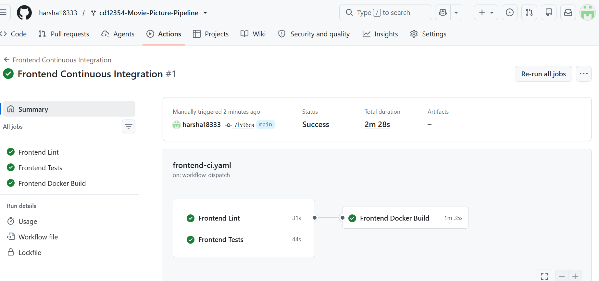
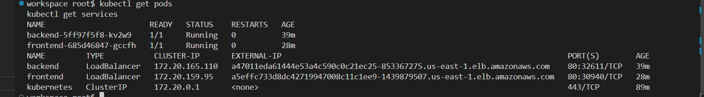
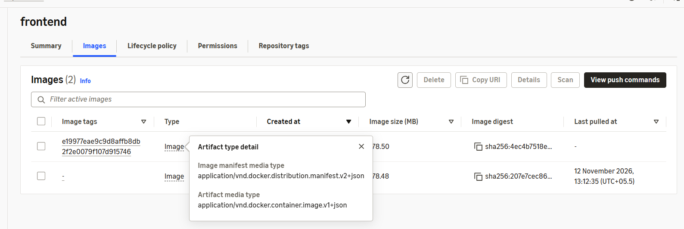
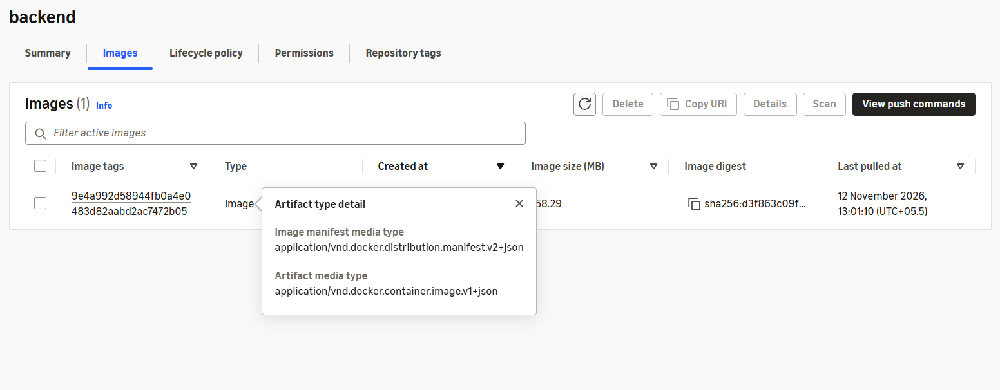

# Movie Picture Pipeline

The Movie Picture Pipeline is a web application that displays a collection of movies. It uses React for the frontend and Python Flask for the backend. The application is deployed on Amazon EKS using GitHub Actions CI/CD pipelines.

## Live Application URLs

### Frontend Application

**Live URL:**

http://a5effc733d8dc42719947008c11c1ee9-1439879507.us-east-1.elb.amazonaws.com

The frontend application displays the movie list and allows users to view individual movie details.

### Backend API

**API URL:**

http://a47011eda61444e53a4c590c0c21ec25-853367275.us-east-1.elb.amazonaws.com/movies

The backend API returns movie information in JSON format.

**Example API Response:**

```json
{
  "movies": [
    {
      "id": "123",
      "title": "Top Gun: Maverick"
    },
    {
      "id": "456",
      "title": "Sonic the Hedgehog"
    },
    {
      "id": "789",
      "title": "A Quiet Place"
    }
  ]
}
```

## Technology Stack

- Frontend: React
- Backend: Python Flask
- Programming Languages: JavaScript and Python
- Containerization: Docker
- Container Registry: Amazon ECR
- Container Orchestration: Amazon EKS
- Infrastructure as Code: Terraform
- CI/CD: GitHub Actions
- Cloud Platform: Amazon Web Services (AWS)

## GitHub Actions CI/CD Workflows

### 1. Frontend Continuous Integration

- Runs automatically on pull requests to the main branch.
- Executes ESLint checks.
- Runs frontend tests.
- Builds the Docker image after linting and testing succeed.
- Supports manual execution through GitHub Actions.

### 2. Backend Continuous Integration

- Runs automatically on pull requests to the main branch.
- Executes backend linting.
- Runs backend tests.
- Builds the Docker image after linting and testing succeed.
- Supports manual execution through GitHub Actions.

### 3. Frontend Continuous Deployment

- Runs automatically when frontend changes are pushed to the main branch.
- Executes linting and tests.
- Builds the frontend Docker image with the backend API URL.
- Pushes the image to Amazon ECR using the Git commit SHA as the tag.
- Deploys the frontend application to Amazon EKS using kubectl.
- Verifies the Kubernetes deployment rollout.
- Supports manual execution.

### 4. Backend Continuous Deployment

- Runs automatically when backend changes are pushed to the main branch.
- Executes linting and tests.
- Builds the backend Docker image.
- Pushes the image to Amazon ECR using the Git commit SHA as the tag.
- Deploys the backend application to Amazon EKS using kubectl.
- Verifies the Kubernetes deployment rollout.
- Supports manual execution.

## AWS Infrastructure

The project infrastructure is provisioned using Terraform.

- Amazon ECR repositories for frontend and backend Docker images.
- Amazon EKS cluster for application deployment.
- Kubernetes deployments for frontend and backend.
- LoadBalancer services to expose both applications.
- IAM permissions for GitHub Actions deployment.

AWS credentials are stored securely in GitHub repository secrets and are not hardcoded in workflow files.

## Deployment Verification

The following deployment checks were completed:

- Frontend CI workflow completed successfully.
- Backend CI workflow completed successfully.
- Frontend CD workflow completed successfully.
- Backend CD workflow completed successfully.
- Frontend Docker image uploaded to Amazon ECR.
- Backend Docker image uploaded to Amazon ECR.
- Frontend Kubernetes pod reached Running status.
- Backend Kubernetes pod reached Running status.
- Frontend application opened successfully in Chrome.
- Movie list and individual movie details displayed successfully.
- Backend `/movies` API returned an HTTP 200 response with movie JSON data.

## GitHub Repository

**Project Source Code:**

https://github.com/harsha18333/cd12354-Movie-Picture-Pipeline

## Project Screenshots

### Frontend Application


### Backend API


### Frontend CI/CD



### Backend CI/CD


### AWS EKS Deployment


### AWS ECR Images



## Conclusion

The Movie Picture Pipeline project demonstrates an automated CI/CD process using GitHub Actions, Docker, Amazon ECR, Amazon EKS, Kubernetes, and Terraform. Both frontend and backend applications were successfully built, deployed, and verified.
